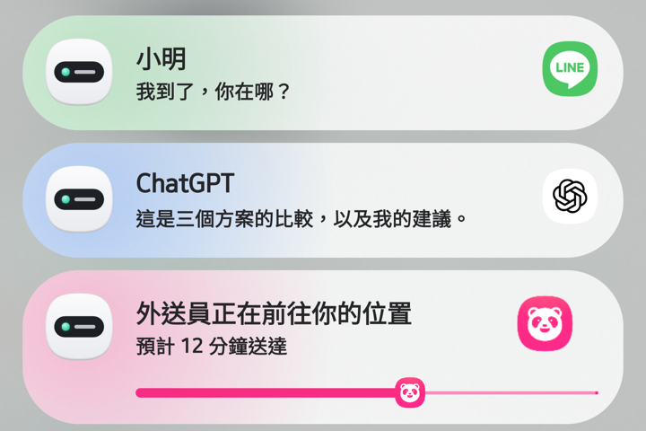
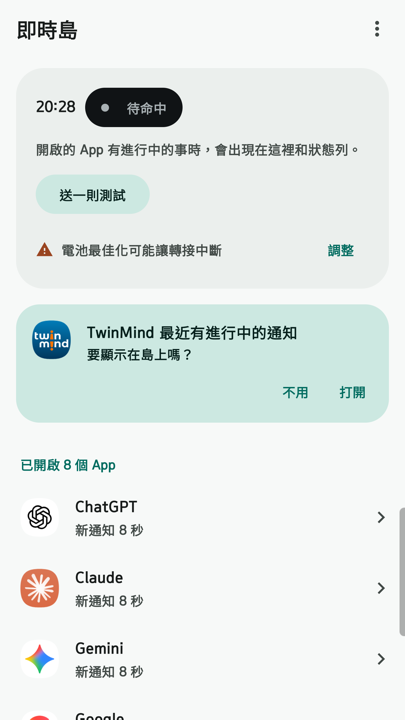
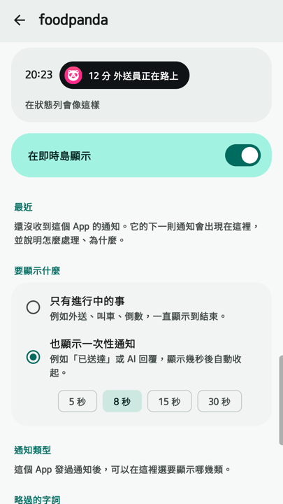

# 即時島（LiveIsland）

[](https://github.com/hphbryan/liveisland/releases/latest) [](https://github.com/hphbryan/liveisland/actions/workflows/ci.yml) [](LICENSE)

**需要 Android 16 以上。** [English](README.md)

即時島會把其他 App 的進行中通知（外送、叫車、導航、上傳、計時……）轉成 **Android 16 即時通知（Live Update）**，
讓它們出現在狀態列膠囊與 **Samsung Now Bar**，即使那個 App 本身不支援。AI 助理（ChatGPT、Claude、Gemini 等）回答完時，
也能在膠囊上短暫顯示「已回覆」。

- **沒有網路權限**、沒有分析追蹤、沒有廣告，通知內容不會離開手機。
- **事件驅動**：不輪詢、不使用 wake lock、不開前景服務，只在收到通知時才動作。
- **使用系統介面**：顯示的是真正的系統即時通知，不是蓋在其他 App 上的浮動視窗。

<p align="center">
  
</p>
<p align="center">
  
  
</p>

## 支援哪些 App？

任何你選的 App 都可以。計程車、外送、共享單車、大眾運輸、運動記錄、專注計時、上傳備份這類會顯示「進行中」狀態的
App，安裝後會出現在推薦清單；完整清單與各 App 的確認程度見 [docs/apps.md](docs/apps.md)（英文）。每個 App 都能
設定一次性通知（例如 AI 回覆）要不要短暫顯示、顯示多久、要顯示哪幾類通知（名稱像廣告的類別預設關閉），以及含有哪些字詞就略過；
略過字詞也可以一次套用到所有 App。「加入 App」可以一鍵打開所有推薦的 App，首頁會建議最近有進行中通知的 App，
快速設定也有一顆按鈕可以暫停全部。

通訊軟體（LINE、WhatsApp、Messenger、Telegram、Discord 等）可以設定**指定的人**：他們的訊息一定會顯示，
也可以設定成讀取前都留在 Now Bar。其他人的訊息只有在「其他人的訊息」選「顯示幾秒」時才會出現。

## 需求

- Android 16 以上（Samsung 為 One UI 8 以上）。已在 One UI 9／Android 17 上測試。
- Samsung 手機上，不在 Samsung 白名單內的 App 要打開「**設定 › 開發人員選項 › 所有 App 的即時通知**」才會顯示。

## 安裝

1. 用手機到 [Releases](../../releases/latest) 下載最新的 `LiveIsland-x.y.z.apk` 並開啟，系統詢問時允許瀏覽器或
   「我的檔案」安裝應用程式。
2. 打開即時島，照最上面的步驟允許讀取通知、允許發送通知、允許顯示為即時通知。如果「讀取通知」的開關是灰色的，
   到「設定 › 應用程式 › 即時島」點右上角 **⋮ ›「允許受限制的設定」**再試一次；不是從商店安裝的 App，Android 都會要求這一步。
3. **只有 Samsung 需要**：先開啟開發人員選項（設定 › 關於手機 › 軟體資訊，連點「**版本號碼**」七下），再到
   「**設定 › 開發人員選項**」打開「**所有 App 的即時通知**」。沒打開的話，One UI 只會顯示 Samsung 白名單內 App 的即時通知。
4. 點「**加入 App**」打開你常用的 App，再從首頁「**送一則測試**」確認。

更新時直接安裝新版 APK 覆蓋舊版，設定會保留。想收到新版通知，在 GitHub 這個頁面上方點
**Watch › Custom › Releases**。

## 運作方式

1. `RelayListenerService`（通知讀取服務）接收你打開的 App 的通知。
2. `Classifier` 判斷每則通知：
   - **進行中的活動**：常駐通知，或有進度條、計時器的通知，會一直轉接到活動結束。
   - **一次性通知**（例如 AI 回覆）：該 App 設成「也顯示一次性通知」時，轉接幾秒（5 到 30 秒，預設 8 秒）。
   - 略過：媒體、來電、群組摘要、系統通知，以及 App 自己就發成即時通知或 Samsung 即時通知的通知（即使你在系統設定關掉了它的即時通知，也不會代替它顯示）、你在系統設定裡設成最小化或暫停的通知、App 或 Android 標成廣告與推薦的通知、「正在背景執行」這類提示，以及勿擾模式中的一次性通知。
3. 狀態列膠囊在展開前就說清楚發生什麼事。`ChipTextExtractor` 找出一個數值（剩餘分鐘、即將進站、還有幾站、距離、
   時刻或百分比），後面接上它指的是什麼：「3 分 12 往火車站」。訊息顯示「Amy：我到了…」，AI 回覆在 App 圖示旁顯示「已回覆」，
   其他一次性通知顯示通知本身的文字。`TextShortener` 把它控制在約 16 欄（中文字算兩欄），放不下的部分 One UI 會捲動顯示。
   每個 App 也可以改成顯示標題、內文，或有單位的數字（`ChipRule`），在 App 頁面或轉接卡片上的「調整顯示」設定。
4. `LiveNotifications` 發出符合即時通知條件的通知，並填入 One UI 自家的欄位，讓 Now Bar 顯示**來源 App 的圖示與名稱**。
5. 鎖定畫面上，轉接的那則不會比原通知顯示得更多：來源 App 在鎖定畫面隱藏內容的話，轉接的也會隱藏。
6. 點一下會開啟來源 App。來源通知上最多兩個按鈕（例如直接回覆）會一起帶過來，仍由原 App 處理；
   「移除」按鈕可先收起，直到來源通知結束。來源通知消失時，轉接的那則也會一起移除。
7. 狀態列一次只顯示一個膠囊，給最後加入的活動。設成「優先顯示」的 App 會在其他活動開始時重新加入，所以能保住膠囊。
   Android 17 上同時有多個活動時，會多一張總覽卡片（`Notification.MetricStyle`）列出每一個的數值。

`core/` 裡的判斷邏輯是純 Kotlin，不依賴 Android，並有單元測試。

## 建置與安裝

```bash
./gradlew :app:testDebugUnitTest :app:lintDebug :app:assembleDebug
adb install -r app/build/outputs/apk/debug/app-debug.apk
```

除錯版的套件名稱是 `io.github.hphbryan.liveisland.debug`，可以和正式版同時安裝。要製作簽署過的正式版，請見 [RELEASING.md](RELEASING.md)。

## 限制

- 來源 App 的原通知仍會留在通知欄，Android 不允許其他 App 收起常駐通知。
- 使用自訂版面的通知（例如 Google 時鐘的計時器）讀不到文字。
- 膠囊文字是從自由文字推測的，有些 App 需要專屬規則，請見 [CONTRIBUTING.md](CONTRIBUTING.md)。
- Samsung 展開卡片的標頭一律顯示發送者（即時島），只有系統等級的 App 才能更改。
- 點轉接的那則用的是原通知的點擊動作；少數 App 的動作只能用一次，之後點原通知可能沒反應。
- 點轉接的訊息不會讓原 App 的通知變成已讀。
- 用來顯示來源 App 圖示與名稱的 One UI 欄位沒有官方文件，之後的版本可能會改變。

## 隱私

請見 [PRIVACY.md](PRIVACY.md)。簡單說：通知只在手機上讀取、用來決定要顯示什麼，不會收集或傳送任何資料；
選用的樣本記錄只存在手機裡，除非你自己分享。

## 授權

[Apache License 2.0](LICENSE)。本專案與 Samsung、Google 及其轉接的任何 App 都沒有關聯。
